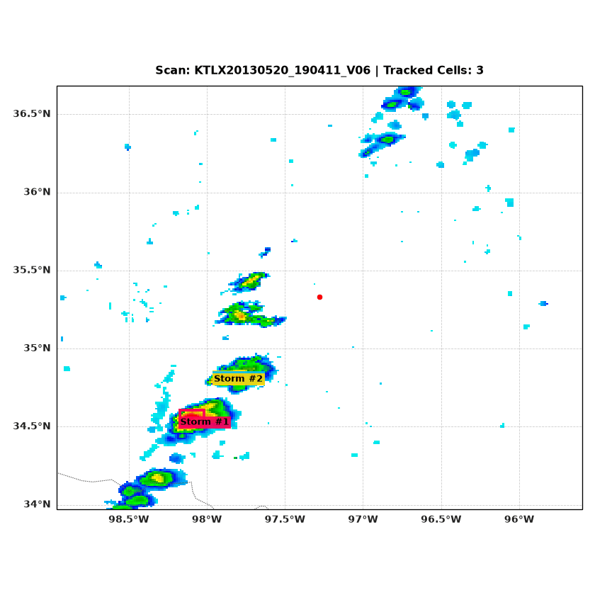

# 🛰️ NEXRAD Convective Storm Tracking

[](https://www.python.org/) [](https://pytorch.org/) [](https://arm-doe.github.io/pyart/) [](https://scitools.org.uk/cartopy/) [](https://opensource.org/licenses/MIT)

Pipeline end-to-end de GeoAI e Visão Computacional para ingestão de dados abertos de radar meteorológico da NOAA (NEXRAD Level II), detecção de núcleos de precipitação intensa via PyTorch e rastreamento cinemático com projeção de trajetória (nowcasting) utilizando o algoritmo SORT (Filtro de Kalman + Algoritmo Húngaro).

<p align="center">
  
</p>

## 🎯 Caso de Estudo

- Radar: KTLX (Oklahoma City, OK — Tornado Alley)
- Evento: Supercélula histórica de Moore, OK (20 de Maio de 2013, 19:00 – 23:00 UTC)
- Produto: Refletividade Equivalente ($Z$) interpolada em CAPPI horizontal a $2.000\text{ m}$ de altitude para mitigar clutter de solo.


## 🏗️ Arquitetura do Pipeline

```text
  [Volumes Brutos NEXRAD (AWS S3)]
                 │
                 ▼
  [Interpolação Polar -> Cartesiana 2D (Py-ART)]
                 │
                 ▼
  [Pseudo-Labeling Físico Morfológico (Z >= 45 dBZ)]
                 │
                 ▼
  [Faster R-CNN ResNet-50-FPN (Adaptada para 1 canal em PyTorch)]
                 │
                 ▼
  [SORT Tracker: Filtro de Kalman + Algoritmo Húngaro]
                 │
                 ▼
  [Renderização Cartográfica com Cartopy (Coastlines, Estados, Lat/Lon)]
```

---

## ⚡ Principais Destaques Técnicos

1. **Engenharia de Dados Geoespaciais:**
   * Leitura de volumes esféricos/polares brutos com `arm_pyart`.
   * Interpolação para grade cartesiana regular horizontal ($256 \times 256$ pixels, resolução $\approx 1.17\text{ km/px}$).
   * Preservação das matrizes de latitude e longitude de cada célula da grade.
   * Normalização física baseada no espectro operacional: $x_{\text{norm}} = \frac{\text{clamp}(Z, 0, 75)}{75.0}$.

2. **Pseudo-Labeling Morfológico Automatizado:**
   * Detecção heurística de núcleos convectivos severos baseada no limiar de $Z \ge 45\text{ dBZ}$.
   * Limpeza de ruído e fechamento morfológico via `cv2.connectedComponentsWithStats`.
   * Exportação para padrão YOLO (`.txt`) e metadados estruturados em `.json`.

3. **Detecção em PyTorch (1-Channel Faster R-CNN):**
   * Adaptação da camada convolucional inicial (`conv1`) da ResNet-50 de 3 para 1 canal, preservando a média dos pesos pré-treinados.
   * Substituição das transformações internas do torchvision (`GeneralizedRCNNTransform`) para 1 canal com `mean=[0.0]`, `std=[1.0]` e resolução nativa ($256\text{ px}$).
   * Split temporal contíguo (não aleatório) para evitar *data leakage* temporal entre varreduras contínuas.

4. **Tracking Cinemático e Nowcasting (SORT):**
   * Associação temporal via **Algoritmo Húngaro** com custo baseado em IoU.
   * Modelagem de velocidade $[\dot{x}, \dot{y}]$ por **Filtro de Kalman**, permitindo estimar a posição futura da célula nos próximos scans ($\approx 15\text{ min}$).

---

## 📁 Estrutura do Repositório

```text
radar-storm-tracker/
├── checkpoints/
│   └── radar_detector_best.pth  # Pesos do modelo treinado
├── data/
│   ├── raw/                     # Volumes brutos NEXRAD
│   ├── processed/
│   │   ├── arrays/              # Grids normalizados (.npy)
│   │   ├── images/              # Gráficos com Cartopy (.png)
│   │   ├── labels/              # Bounding boxes YOLO (.txt)
│   │   └── grid_coords.npz      # Coordenadas geográficas (Lat/Lon)
│   └── storm_tracking_inferred.gif
├── src/
│   ├── model.py                 # Faster R-CNN adaptada (1 canal)
│   └── tracker.py               # SORT (Kalman Filter + Hungarian Algorithm)
├── download_event.py            # Download via AWS S3 / nexradaws
├── extract_labels.py            # Extração de pseudo-labels morfológicos
├── inspect_detections.py        # Validação visual georreferenciada
├── process_files.py             # Interpolação para grade cartesiana
├── radar_dataset.py             # PyTorch Dataset e DataLoader customizados
├── train.py                     # Pipeline de treinamento com Early Stopping
├── inference_and_track.py       # Pipeline integrado (PyTorch -> SORT -> GIF)
├── environment.yml              # Ambiente Conda reproduzível
└── README.md
```

---

## 🚀 Instalação e Uso

### 1. Clonar o repositório e criar o ambiente

```bash
git clone https://github.com/SEU_USUARIO/radar-storm-tracker.git
cd radar-storm-tracker

# Criação do ambiente com Conda
conda env create -f environment.yml
conda activate radar-tracker
```

### 2. Download dos dados abertos (NEXRAD AWS S3)

```bash
python download_event.py
```

### 3. Pré-processamento e Geração de Labels

```bash
# Interpolação para grade cartesiana
python process_files.py

# Extração de pseudo-labels
python extract_labels.py
```

### 4. Treinamento da Faster R-CNN

```bash
python train.py
```

### 5. Inferência e Geração do GIF de Tracking

```bash
python inference_and_track.py
```

---

## 🛠️ Stack Tecnológica

* **Linguagem:** Python 3.11
* **Deep Learning:** PyTorch, Torchvision
* **Dados Meteorológicos:** Py-ART (`arm_pyart`), `nexradaws`
* **Geoprocessamento e Cartografia:** Cartopy, NumPy, SciPy
* **Visão Computacional & Tracking:** OpenCV, `filterpy`
* **Visualização:** Matplotlib, Pillow

---

## 📜 Licença

Distribuído sob a licença MIT. Veja `LICENSE` para mais informações.